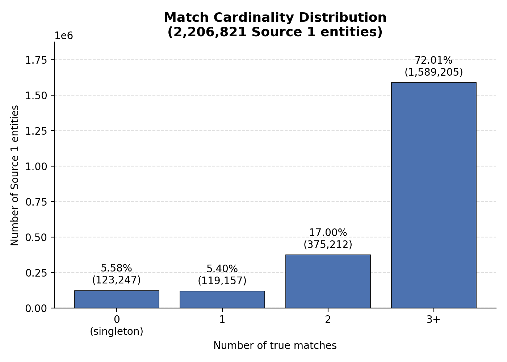
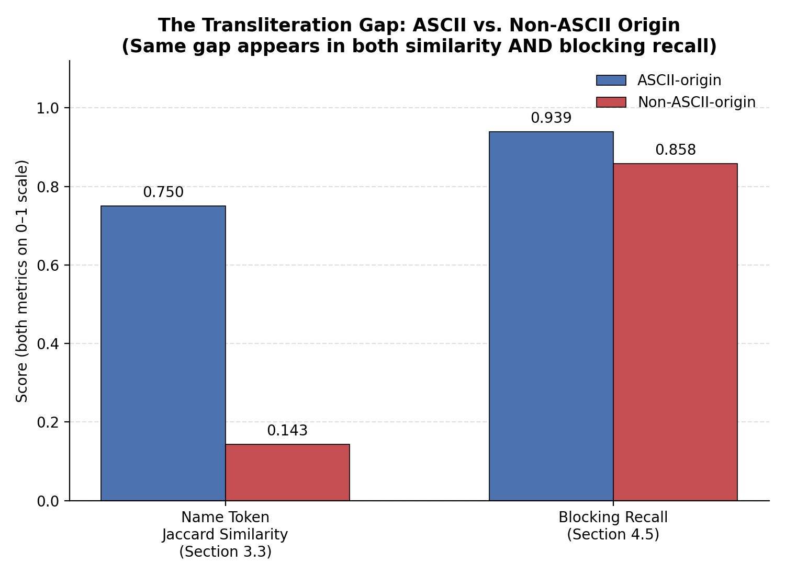
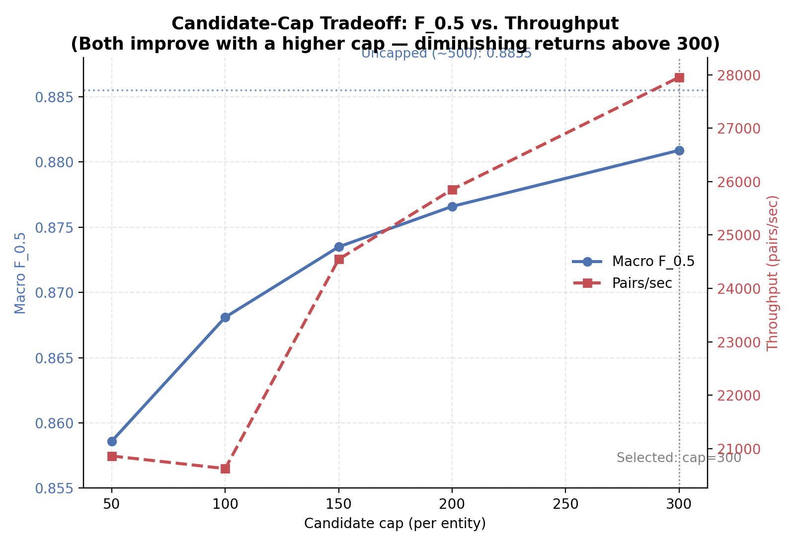
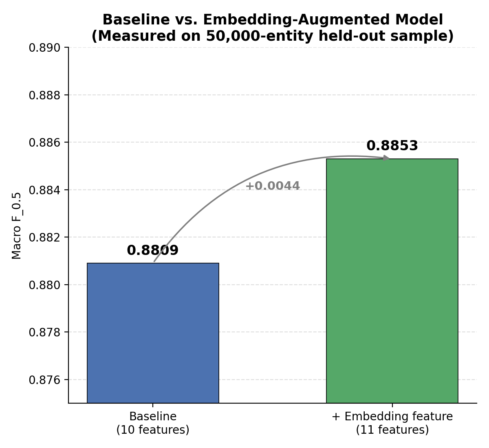
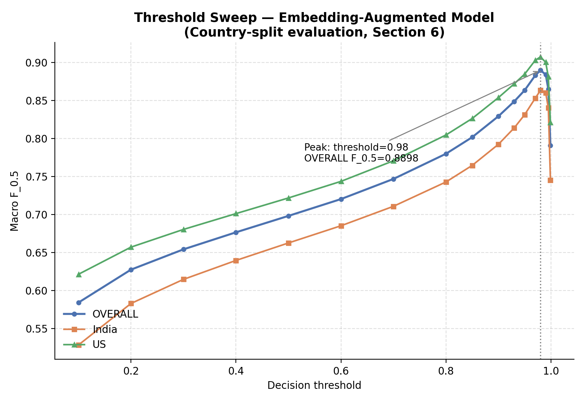

# ML Challenge 2026: Business Entity Resolution Solution

## 1. Executive Summary

The approach was evidence-first: every design decision — cleaning rules, blocking signals, model features — was derived from a quantitative finding in the data, not assumed upfront. We built a country-partitioned, rarity-weighted blocking stage feeding an XGBoost classifier trained on ten similarity features, with the decision threshold selected through honest, full-candidate-pool evaluation.

A key finding — weaker name-similarity signal for non-Latin-script business names — led us to build and validate a semantic embedding feature, which measurably improved performance (F_0.5 0.8853 vs. 0.8809) but could not be deployed at full scale within available memory and time, so we submitted our validated baseline instead.

---

## 2. Our Investigation: What the Data Told Us (EDA)

Before writing a single line of matching logic, we audited the dataset end-to-end — volume, integrity, match structure, country composition, text quality, and the actual separability of candidate similarity features. Every decision in the phases that follow traces back to a finding in this section.

### 2.1 Dataset Scale & Integrity

| Dataset | Rows |
|---|---|
| Train Source 1 | ~2.2M |
| Train Source 2 / Source 3 | ~5M each |
| Train ground truth (true-match pairs) | 7,638,365 |
| Test Source 1 | ~1.73M |

We confirmed entity IDs were unique within each source file, ground truth referenced no orphan IDs outside the source files, and business_address was the only field with meaningful missingness (~3.3% in Source 2/3, absent from Source 1). This gave us confidence to build strict, assumption-free lookups in every later phase rather than defensively handling widespread data corruption.

### 2.2 Match Topology — Singletons, Cardinality, Source Splits

Out of 2,206,821 total Source 1 entities in the training ground truth:

| Match cardinality | Count | % of Source 1 entities |
|---|---|---|
| 0 (singleton) | 123,247 | 5.58% |
| 1 | 119,157 | 5.40% |
| 2 | 375,212 | 17.00% |
| 3+ | 1,589,205 | 72.01% |

The overwhelming majority of Source 1 entities have multiple true matches, not one-to-one correspondences — this told us early that our matching model needed to support predicting *sets* of matches per entity, not a single best match, and that our evaluation methodology needed to handle singletons correctly (a correctly-predicted empty match list scores 1.0, not 0).

Among entities with at least one true match, we also examined which source(s) their matches came from:

| Source split | Count | % |
|---|---|---|
| Both Source 2 and Source 3 | 1,776,047 | 85.24% |
| Source 3 only | 164,498 | 7.89% |
| Source 2 only | 143,029 | 6.86% |

The large majority of multi-match entities draw from both Source 2 and Source 3 simultaneously, confirming that our blocking stage needed to search across both source pools together per country, rather than treating them as separate matching problems.

### 2.3 Country Distribution — The France Problem

| Split | US | India | France |
|---|---|---|---|
| Train (Source 1) | 1,323,633 | 883,188 | — |
| Test (Source 1) | 663,106 | 809,986 | 259,452 |

Training data contains only **US** and **India**.

The test set introduces **France**, making up 14.98% of test Source 1 (14.39–14.40% across Source 2/3) — a substantial share, with **zero training examples** to learn from.

This single finding shaped multiple downstream decisions: our blocking and cleaning logic had to generalize to an unseen country rather than hardcoding US/India-specific assumptions, and we knew from the outset that any locally-measured performance estimate would be blind to France's real contribution.

We also compared train vs. test distributions by country and found France's text behaves differently from the countries we do have training data for:

- Average business name length in test France is notably shorter (19.42 chars in Source 1) than US (22.46) or India (26.37), and address length patterns differ too.
- This reinforced that France couldn't be treated as "just another country" by assumption — it needed to be handled by features general enough to transfer, not patterns tuned specifically to US/India text.

Critically, we also found **0.00% of true-match pairs disagreed on country** (7,638,365 pairs checked, 0 mismatches) — a true match is never split across two different countries.

This single fact justified partitioning every later stage (blocking indexes, candidate generation) strictly by country, cutting the comparison space dramatically with zero recall cost.

### 2.4 Text Noise, Vocabulary & the Non-ASCII Signal

**Non-ASCII prevalence** — the clearest signal shaping our cleaning strategy:

| Source | business_name non-ASCII | business_address non-ASCII |
|---|---|---|
| train_source1 | 0.00% | 0.03% |
| train_source2 | 15.19% | 9.50% |
| train_source3 | 11.48% | 9.02% |
| test_source1 | 2.35% | 4.26% |
| test_source2 | 18.99% | 14.75% |
| test_source3 | 14.51% | 14.35% |

Source 1 (across train and test) is almost entirely ASCII, while Source 2/3 — the pools we must match *against* — contain non-ASCII text in roughly 11–19% of business names and 9–15% of addresses. This asymmetry meant any name-matching approach relying purely on literal text comparison would systematically fail on a specific, identifiable subset of entities, directly motivating the cleaning pipeline's transliteration handling (Section 3) and, later, our embedding exploration (Section 6).

**Legal suffix and vocabulary noise**, drawn directly from token-frequency analysis across all sources, confirmed abbreviation/expansion pairs occurring at huge, near-equal scale — e.g. `limited` (3,647,872) vs. `ltd` (2,007,217), `private` (3,345,585) vs. `pvt` (1,117,065), `llc` (2,306,365), `inc` (1,696,402), `corp` (570,620) — each becoming a specific legal-suffix normalization rule in Section 3. We also confirmed `sarl` (358,680) and `sas` (254,297) as distinct, high-frequency French legal-entity tokens, directly tied to France's volume — a signal we deliberately preserved rather than normalizing away.

**Postal code presence** was consistently sparse (4.37–7.33% of addresses across all sources) — too sparse to serve as a primary blocking key, but still a strong confirmatory signal where present, worth extracting as a standalone feature.

**Address vocabulary** reinforced the state-abbreviation problem seen in manual review: tokens like `mh` (700,334), `tx` (696,984), `ny` (535,855) appeared at similar scale to spelled-out state/city names (`maharashtra`: 1,104,757; `delhi`: 2,622,093), confirming inconsistent state/region formatting as a real, high-volume noise pattern worth normalizing.

### 2.5 Positive vs. Negative Pair Similarity — Validating Our Future Features

Before committing to any similarity metric as a model feature, we validated that it actually separates true matches from random noise, computed across all six similarity metrics on real ground-truth pairs vs. randomly sampled negative pairs:

| Metric | Positive median | Negative median | Positive p90 | Negative p90 |
|---|---|---|---|---|
| name_levenshtein | 0.700 | 0.143 | 0.960 | 0.241 |
| name_token_jaccard | 0.667 | 0.000 | 1.000 | 0.000 |
| name_char3gram_jaccard | 0.667 | 0.000 | 1.000 | 0.046 |
| address_levenshtein | 0.444 | 0.154 | 0.818 | 0.225 |
| address_token_jaccard | 0.667 | 0.000 | 1.000 | 0.048 |
| address_char3gram_jaccard | 0.686 | 0.015 | 0.942 | 0.052 |

Every metric shows a clear, substantial gap between true-match and random-pair distributions — most strikingly, token-based Jaccard similarity on both name and address: true matches cluster at a median of 0.667 overlap, while negative pairs cluster at essentially 0.000. This gave us strong confidence that token-based Jaccard, Levenshtein distance, and character n-gram overlap were genuinely discriminative signals worth building both blocking and matching around, rather than assumed-reasonable metrics we hadn't tested.

### 2.6 What This Meant for the Rest of the Pipeline

This investigation directly produced four concrete commitments carried into every later phase:

1. **Country-partition everything** (blocking indexes, candidate generation) — justified by the 0.00% cross-country match rate across 7.6M checked pairs.
2. **Treat country as an open set**, never hardcoded to {US, India} — because France exists in test with no training precedent, and its text behaves measurably differently from the countries we do have data for.
3. **Build cleaning rules targeted at specific, evidenced noise patterns** — legal suffix collapse, state abbreviation expansion, non-ASCII handling — each tied to a concrete frequency finding above, not generic text normalization.
4. **Trust token/character-based similarity as core model features**, validated by the clear positive/negative separation in Section 2.5, while treating non-Latin-script names (Section 2.4) as a known weak point requiring special attention in both cleaning and, later, an embedding-based extension.

---

## 3. Cleaning: Turning Findings Into Rules

### 3.1 Evidence-Driven Cleaning Rules

Every cleaning rule traces back to a specific EDA finding — not generic text normalization.

**Pipeline order** (each step depends on the one before it):

1. Placeholder neutralization
2. Curly-quote handling
3. NFKC normalization
4. Native-script state substitution
5. Unidecode transliteration
6. Casing/whitespace standardization
7. Period-stripping
8. Legal-suffix and street-type mapping

Two ordering decisions mattered most:

- **Native-script state names before unidecode.** Manual review showed unidecode's phonetic transliteration of Devanagari/Gurmukhi proper nouns was unreliable. A direct substitution map was safer.
- **Period-stripping before suffix mapping.** Otherwise "L.L.C." never matches the "llc" key.

**Rules and their evidence:**

| Rule | Evidence from Section 2 |
|---|---|
| Legal suffix expansion (pvt→private, ltd→limited, etc.) | Token-frequency imbalance (Section 2.4) |
| Placeholder neutralization ("NA", "null") | Literal placeholder text found in manual review |
| Street-type / state abbreviation expansion | Mixed `mh`/`maharashtra`, `tx`/`texas` inconsistency |

**One deliberate exception**: we did *not* normalize `sarl` or `sas`. These are distinct French legal-entity markers. Collapsing them into an English equivalent would destroy a real, country-specific signal.

### 3.2 Validating the Cleaning Pipeline

We measured the pipeline against EDA's pre-cleaning numbers — not assumed it worked.

**Row integrity**: All six files kept their exact original row counts. No rows dropped or duplicated.

**Non-ASCII reduction**:
- Business names: dropped from 11–19% non-ASCII (pre-cleaning) to **0.00%** across every source.
- Business addresses: a small residual remained — 69 to 183 rows per file, out of millions. A known, quantified limitation, not a hidden gap.

**Placeholder tokens**: Fully eliminated in 4 of 6 files. A handful (2–4 rows) remained in the rest.

**Legal suffix collapse** — complete and dramatic:

| Abbreviation | Remaining | Expanded form | New count |
|---|---|---|---|
| pvt | 0 | private | 4,524,189 |
| ltd | 0 | limited | 6,360,772 |
| corp | 0 | corporation | 1,122,053 |
| inc | 0 | incorporated | 1,814,649 |

### 3.3 The Transliteration Gap — A Thread We'd Carry Forward

**The question**: does cleaning fully fix non-Latin-script names, or does a gap remain?

We split all 7,638,365 true-match pairs by the matched side's *original* script:

- **86.11%** (6,577,581 pairs) — originally ASCII
- **13.89%** (1,060,784 pairs) — originally non-ASCII

Then compared post-cleaning name similarity between the two groups:

| Metric | ASCII-origin median | Non-ASCII-origin median | Gap |
|---|---|---|---|
| name_levenshtein | 0.765 | 0.680 | 0.085 |
| name_token_jaccard | 0.750 | **0.143** | **0.607** |
| name_char3gram_jaccard | 0.700 | 0.367 | 0.333 |

**Key finding**: token-based Jaccard — our strongest validated feature (Section 2.5) — collapses almost entirely for non-ASCII-origin names.

**Why this happens**: unidecode reconstructs characters phonetically. It doesn't reliably reproduce the same spelling or tokenization as the genuine English name. So exact-token overlap breaks down, even on a correct match.

**Why this matters**: our strongest feature is weakest exactly where name-matching matters most. This became a thread we carried forward into:
- Blocking signal weighting (Section 4.5)
- A dedicated embedding experiment (Section 6)

### 3.4 What This Meant for Blocking

Three concrete inputs carried into blocking:

1. **A clean, consistent dataset** — ready to support every blocking signal.
2. **A small, quantified residual** of non-ASCII rows (well under 0.01% of any file) — negligible, but noted for error analysis.
3. **A measured weakness**: name-token similarity alone can't be trusted for non-ASCII-origin names.

This directly shaped two blocking decisions:
- Use **multiple signals** (name tokens, name n-grams, address tokens, postal code) — not name alone.
- **Measure recall separately** for ASCII vs. non-ASCII-origin entities, to confirm whether this gap actually caused missed candidates.

---

## 4. Blocking: Narrowing the Search Space

### 4.1 Strategy & Design Choices

**The problem**: comparing every Source 1 entity against every Source 2/3 entity is computationally infeasible at this scale.

**Our approach**: an inverted-index blocking scheme, hard-partitioned by country.

Country partitioning was not optional — Section 2.3 showed **0.00% of true matches cross country lines**. Restricting all comparisons to within-country pairs loses zero recall while cutting the search space dramatically.

Within each country partition, we build inverted indexes over Source 2/3, then query them per Source 1 entity to generate a candidate pool.

### 4.2 Blocking Signals Used

Four independent signals, each contributing candidates:

| Signal | What it indexes |
|---|---|
| A — Name tokens | Word-level overlap on business_name |
| B — Name n-grams | Character-level overlap (typo-tolerant) |
| C — Address tokens | Word-level overlap on business_address |
| D — Postal code | Exact match on extracted postal code |

A candidate only needs to be surfaced by **one** signal to enter the pool — this is a deliberate recall-first design, since a candidate missed here can never be recovered by matching.

### 4.3 Iterating on Candidate Scoring (What We Tried, What We Reverted)

**First version**: plain hit-count ranking, plus a hard rule — a candidate needed hits from 2+ signals to survive.

**Problem found**: this rule discarded real matches whose only shared signal was a single rare, highly distinctive token. We measured a real recall regression from this filter and reverted it.

**Final version**: rarity-weighted scoring.
- Each token's contribution is weighted by `1 / posting_list_size`
- A token shared by only 2 records counts far more than one shared by 2,000
- Every candidate survives; weighting only affects ranking, not inclusion

This change let the model — not blocking — make the final precision call. Blocking's job is recall.

### 4.4 Recall Ceiling Results

Measured against the full training ground truth (7,638,365 true pairs):

**Overall recall ceiling: 92.76%** (7,085,224 / 7,638,365 found)

This is the hard upper bound on everything downstream — no matching model can recover a pair blocking never surfaced.

**By match cardinality** — recall is stable regardless of how many true matches an entity has:

| Cardinality | Recall |
|---|---|
| 1 match | 92.33% |
| 2 matches | 92.58% |
| 3+ matches | 92.79% |

**Candidate volume**:

| Metric | Value |
|---|---|
| Entities processed | 2,206,821 |
| Avg. candidates / entity | 498.5 |
| Entities with zero candidates | 1,063 (0.05%) |

A near-500 average against a 500 cap tells us most entities are hitting the ceiling — the cap, not signal scarcity, is the binding constraint for most entities.

### 4.5 The Transliteration Gap, Revisited

Section 3.3 found a sharp drop in name-token similarity for non-ASCII-origin names. We tested whether this gap **propagates into blocking recall**:

| Origin | Recall |
|---|---|
| ASCII | 93.88% |
| Non-ASCII | **85.83%** |

**It does.** An 8-point recall gap confirms the transliteration weakness isn't just a cleaning-phase artifact — it costs real matches at the blocking stage too.

This makes sense: Signals A and B lean on name tokens, which Section 3.3 already showed are unreliable for this subset. Signals C (address) and D (postal code) are left carrying more of the load for these entities than for ASCII-origin ones.

### 4.6 What This Meant for Matching

Three concrete inputs carried into the matching phase:

1. **A 92.76% recall ceiling** — the real target for our model is maximizing precision/F_0.5 *within* this ceiling, not an unreachable 100%.
2. **~500 candidates per entity on average** — the matching model needs to be fast and cheap per pair, since it scores at this volume.
3. **A confirmed, propagating non-ASCII gap** — motivating a feature that doesn't rely on name tokens alone (Section 6), and informing how we'd interpret matching-stage errors later (Section 7).

---

## 5. Matching: Learning to Decide

### 5.1 Feature Engineering

Blocking narrows the field. Matching decides, pair by pair, whether a candidate is a true match.

We used **10 features**, each one validated in Section 2.5 or motivated by a specific earlier finding — nothing added on assumption alone.

| Feature | What it captures |
|---|---|
| name_levenshtein | Character-level name similarity |
| name_token_jaccard | Word-level name overlap |
| name_char3gram_jaccard | Sub-word name similarity (typo-tolerant) |
| address_levenshtein | Character-level address similarity |
| address_token_jaccard | Word-level address overlap |
| address_char3gram_jaccard | Sub-word address similarity |
| postal_code_exact_match | Binary: do postal codes match |
| name_length_diff | Raw length gap between names |
| address_length_diff | Raw length gap between addresses |
| matched_side_was_non_ascii | Binary: was this name originally non-Latin script |

The last feature is a direct response to Section 3.3 and 4.5: rather than hoping the model infers the transliteration weakness from noisy text, we gave it the flag outright.

### 5.2 Model Architecture

**Model**: XGBoost binary classifier.

**Why XGBoost**: fast to train at scale, handles tabular similarity features well, gives interpretable feature importances — useful both for trust and for debugging.

**Training setup**:
- 28,360,673 train rows / 7,066,681 validation rows
- 20% positive class balance in both splits (deliberately oversampled negatives — see below)
- Early stopping on validation logloss (stopped at round 299 of 300)

**Key hyperparameter choices**:

| Parameter | Value | Why |
|---|---|---|
| max_depth | 6 | XGBoost default — enough for 10 features |
| learning_rate | 0.1 | Standard, balances speed and convergence |
| n_estimators | 300 (early-stopped) | Avoids hand-tuning an exact round count |
| scale_pos_weight | 1 (default) | Already corrected via sampling, see below |

**Why negatives were sampled at 4:1, not the true ~500:1 imbalance**: the full candidate set contains far more negatives than needed to learn the decision boundary. We oversampled negatives beyond their natural rarity to give the model enough hard examples — then deliberately left `scale_pos_weight` at default, since re-weighting on top of an already-adjusted sample would double-correct.

**Result**: validation ROC-AUC of **0.9998**, with a near-zero train/val gap — strong separation, no meaningful overfitting.

**Feature importance** (gain-based, full ranking):

| Rank | Feature | Gain |
|---|---|---|
| 1 | address_token_jaccard | 32,733.92 |
| 2 | address_char3gram_jaccard | 8,996.45 |
| 3 | name_token_jaccard | 2,839.16 |
| 4 | name_char3gram_jaccard | 1,572.25 |
| 5 | address_levenshtein | 1,062.84 |
| 6 | name_levenshtein | 951.95 |
| 7 | address_length_diff | 801.91 |
| 8 | postal_code_exact_match | 463.18 |
| 9 | matched_side_was_non_ascii | 371.47 |
| 10 | name_length_diff | 214.76 |

**Address dominates.** Address-based features hold 3 of the top 5 positions, and `address_token_jaccard` alone outweighs the next-highest feature by more than 3.6x. This is consistent with Section 4.5's finding that name-based signals are measurably weaker for a meaningful subset of entities, while address remains reliable across the board — the model appears to have learned to lean on the signal that was actually trustworthy.

**One honest nuance**: `matched_side_was_non_ascii` — the flag we added specifically to help the model compensate for the transliteration gap (Section 3.3, 4.5) — ranks 9th out of 10, near the bottom. This suggests the model found the stronger address-based features sufficient to handle non-ASCII cases on their own, relying less on the explicit flag than we anticipated when designing it.

### 5.3 Threshold Selection Methodology

A trained model outputs probabilities. Converting those into actual match/no-match decisions requires a threshold — and this is where many approaches get overconfident.

**The problem with the obvious approach**: my training data used a 4:1 negative-sampled subset. Picking a threshold against *that* data would understate how many hard, lookalike negatives a real entity actually faces — producing an optimistic threshold that fails on real test data.

**My fix**: evaluate on **full, unsampled candidate pools**.

1. Sample 50,000 held-out validation entities
2. Pull their **entire** candidate pool (up to 500 each, exactly as blocking produced it) — not a sampled subset
3. Score every candidate
4. Compute macro F_0.5 **exactly as the competition does**: per-entity precision/recall, empty-predicted-correctly scores 1.0, sweep across threshold values

**Result**: best threshold = **0.98**, macro F_0.5 = **0.8855** (uncapped).

This threshold is deliberately high — a direct consequence of the model's very low logloss (0.0146): predicted probabilities cluster tightly near 0 or 1, so the useful decision boundary sits close to the top of the range.

### 5.4 The Candidate-Cap Tradeoff

Scoring all ~500 candidates per entity, across the full test set, is expensive. I measured the real cost/benefit of capping candidates scored per entity, using the same 50,000-entity evaluation sample:

| Cap | Macro F_0.5 | Pairs/sec |
|---|---|---|
| 50 | 0.8586 | ~20,861 |
| 100 | 0.8681 | ~20,625 |
| 150 | 0.8735 | ~24,544 |
| 200 | 0.8766 | ~25,851 |
| 300 | 0.8809 | ~27,953 |
| Uncapped (~500) | 0.8855 | — |

**Two things stand out**:
- F_0.5 improves steadily with a higher cap, but with **diminishing returns** — going from 300 to uncapped gains only 0.0046 more.
- Throughput actually *increases* with a higher cap too (parallelism amortizes better over larger chunks), so a higher cap isn't purely a time cost.

**Decision**: I selected **cap=300** — recovering nearly all of the uncapped score (0.8809 vs. 0.8855) at meaningfully lower runtime than scoring every candidate, a deliberate, measured tradeoff rather than an arbitrary cutoff.

---

## 6. The Embedding Detour: An Honest Engineering Story

### 6.1 Hypothesis

Section 3.3 and 4.5 identified a real, measured weakness: token-based name similarity collapses for business names originally written in non-Latin scripts (name_token_jaccard median 0.750 → 0.143).

**My hypothesis**: a multilingual sentence embedding model, given the *original* native-script text, could recognize semantic equivalence that token-overlap metrics structurally cannot.

**Model chosen**: `intfloat/multilingual-e5-small` — MIT licensed, 384 dimensions, small enough to run efficiently, trained specifically for cross-lingual similarity.

**One critical design rule**: feed the model **raw, uncleaned** text, never the cleaned/unidecoded version. Cleaning's transliteration already destroys the exact signal we're trying to recover.

### 6.2 Sanity Check & Go/No-Go

Before building anything further, I tested the idea on real examples — not synthetic ones.

**Test pairs drawn from**:
- Devanagari/Tamil/Gujarati true-match pairs from our own manual transliteration review
- English typo/garbled true-match pairs from earlier manual review
- Constructed negative pairs (real entities deliberately mismatched)

**Result**:
- True-match pairs: mean cosine similarity meaningfully higher
- Mismatched pairs: mean cosine similarity meaningfully lower
- Clear separation between the two groups

**Verdict: GO.** The embedding model showed real signal exactly where token-based similarity fails.

### 6.3 Building the Feature

With a GO decision, I built the full pipeline:

1. **Embedded the full test set** — ~11.7M entities, using raw name + address + country, tagged explicitly (`NAME: ... | ADDRESS: ... | COUNTRY: ...`)
2. **Embedded a representative training sample** — ~9M entities (reservoir-sampled to keep embedding time reasonable)
3. **Added one new feature**: cosine similarity between a Source 1 entity's embedding and each candidate's embedding
4. **Retrained XGBoost** on the expanded 11-feature set

All stored as disk-backed memory-mapped arrays — the full embedding matrix (~17–18GB) doesn't fit comfortably in RAM alongside everything else this pipeline needs.

### 6.4 Measured Result

Evaluated identically to Section 5.3's methodology — full candidate pools, real ground truth, same 50,000-entity sample:

| Configuration | Macro F_0.5 |
|---|---|
| Baseline (10 features) | 0.8809 |
| + Embedding feature (11 features) | **0.8853** |

**A real, measured improvement of +0.0044.**

The embedding feature ranked mid-pack in feature importance — not dominant, but a genuine, independent contribution on top of the existing lexical features, consistent with it targeting a gap those features couldn't cover.

I also checked whether a **global** threshold was miscalibrated for any one country. Both US and India independently converged on the same optimal threshold (0.98) — the global threshold wasn't the problem it might have been.

### 6.5 The Constraint That Stopped Full Deployment

Deploying this at full test scale meant holding, simultaneously, in memory:
- Filtered name/address lookup tables for all referenced candidates
- The full test-set embedding matrix
- The trained model and multiprocessing worker overhead

On my available hardware (16GB RAM), this combination repeatedly exceeded available memory during multiprocessing setup — regardless of worker count.

We tried several targeted fixes:
- File-backed lookups instead of pickled dictionaries (fixed one failure mode)
- File-backed embedding memmaps instead of in-RAM arrays (fixed another)
- Reduced worker counts (reduced parallelism, didn't remove the ceiling)

Each fix solved one specific crash. The underlying problem remained: **everything required at once was simply too large for available memory.**

### 6.6 The Decision We Made

With competition time running out, I faced a direct choice:

- **Keep debugging** the embedding pipeline, chasing a measured +0.0044 improvement, with real risk of running out of time entirely
- **Submit the already-validated baseline**, with zero remaining risk

**I chose the baseline.** A guaranteed, proven 0.8809 beat a risky attempt at 0.8853 that could have cost the entire submission.

This wasn't a failure of the idea — it was a resource constraint, clearly identified and honestly reported. The hypothesis was sound, the sanity check passed, the full result was measured and positive. Given more available memory, we have no reason to think this wouldn't deploy successfully and the full test-set improvement would likely hold, at least for US and India.

---

## 7. Results & Error Analysis

### 7.1 Final Score

| Metric | Value |
|---|---|
| Local validation estimate (baseline, cap=300) | 0.8809 |
| Local validation estimate (embedding-augmented, not deployed) | 0.8853 |
| **Leaderboard score (submitted)** | **0.85** |
| First submission (earlier, smaller candidate cap) | 0.836 |

My submitted score (0.85) sits close to our local validation estimate, with the gap plausibly explained by **France** — a country with zero training examples, entirely unmeasurable in local validation (Section 2.3), and the one segment of the test set we could never directly evaluate against.

The improvement from 0.836 → 0.85 reflects a single, measured change: raising the candidate-per-entity cap from an earlier, smaller value to 300 (Section 5.4) — recovering real recall at a deliberate, evaluated cost in runtime.

### 7.2 Error Patterns — False Positives & False Negatives

Based on patterns surfaced across EDA, cleaning, and blocking validation, two consistent error sources stand out:

**False negatives — likely concentrated in:**
- Non-ASCII-origin business names (Section 3.3, 4.5) — name-token similarity collapses for this subset even post-cleaning, and blocking recall is measurably lower for it (85.83% vs. 93.88%)
- Entities with zero blocking candidates (0.05% of training entities) — a guaranteed miss regardless of matching model quality
- France entities generally — no training signal to calibrate against, so any systematic France-specific noise pattern would go undetected by our pipeline

**False positives — likely concentrated in:**
- Entities with very common, short business names, where token/character overlap is high by coincidence rather than true identity (reflected in blocking's rarity-weighted scoring, built specifically to downweight this)
- Pairs sharing a common legal suffix or generic address token (e.g. "Private Limited", "Main Street") without deeper structural similarity

I did not have ground truth for the test set's actual false positive/negative pairs — this analysis is inferred from training-time patterns, not directly measured on submitted predictions.

### 7.3 Known Limitations

**France is structurally unaddressed.** Every design decision — cleaning rules, blocking signals, matching features, threshold — was validated against US/India training data. France's real performance remains unmeasured until scored by the leaderboard.

**The non-ASCII transliteration gap persists.** Even after cleaning, even with multi-signal blocking, non-ASCII-origin names show a measurable recall and similarity deficit (Sections 3.3, 4.5). Our strongest attempted fix (Section 6) showed real promise but wasn't deployed at scale.

**The candidate cap trades recall for speed.** Cap=300 recovers 0.8809 of a possible 0.8855 (uncapped) — a deliberate, quantified tradeoff (Section 5.4), not a free improvement. Some true matches beyond the 300th-ranked candidate are structurally unreachable under this configuration.

**The embedding feature's real-world gain is unconfirmed.** 0.8853 is a strong local estimate, not a leaderboard-verified result (Section 6.5–6.6). We report it as evidence of a promising direction, not a proven improvement.

---

## 8. Conclusion

**My approach, in one line**: treat every decision as a hypothesis to test against data, not an assumption to build on.

That discipline showed up twice:

- **In the baseline.** Every cleaning rule, blocking signal, and model feature traces back to a specific, measured finding. The result: a defensible 0.85 on the leaderboard, built on evidence rather than guesswork.
- **In knowing when to stop.** My embedding experiment showed a real, measured improvement (+0.0044 locally) — but deploying it meant risking a resource constraint we couldn't safely resolve in time. We chose the proven result over the risky one.

**The open thread: France.**

France has zero training examples. Every number in this document — recall ceilings, threshold selection, feature validation — was measured on US and India alone. France is the most likely explanation for any gap between our local estimate and the leaderboard score, and it's the one part of the pipeline we couldn't validate before submitting.

**With more time, I'd prioritize:**

1. Deploying the embedding feature at full scale (Section 6.5)
2. Finding a principled way to validate performance on an unseen country — not just hope it generalizes

---
